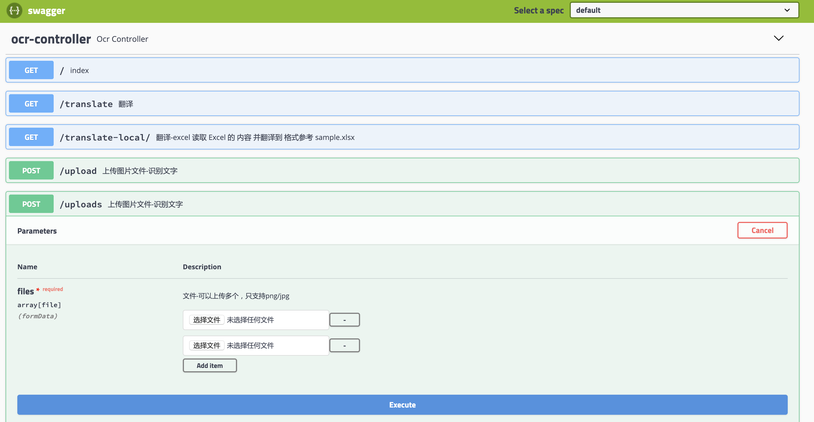
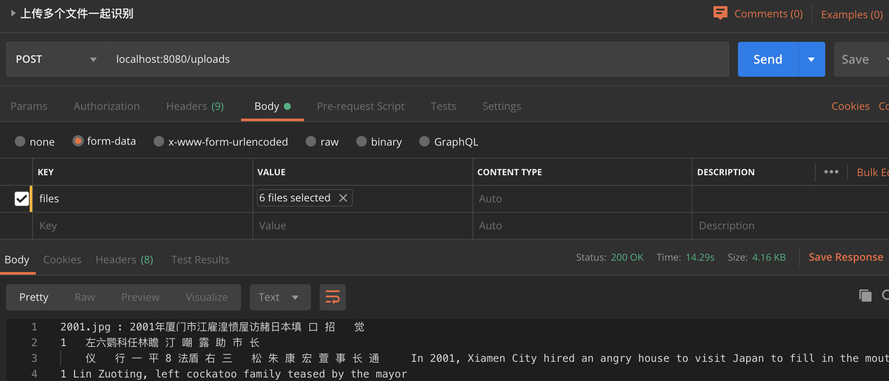

### ocr-service is just a toy

there is the features

1. [x] ocr the pnc/jpg file with chinese/english/dight/japanese
2. [x] translate content with Google Translate Api
3. [x] multi file ocr
4. [x] translate excel file with fixed format!
--

Excel 格式如下 (格式参考 sample.xlsx)

|name or no| origin-content | translated-content|
|---| -- | -- 
|1 | hello|こんにちは|

接口定义见 `OcrController.java`。旧版 Swagger UI 已移除；可选 Swagger JSON 默认关闭。




### images



### depend on

you need to install your tesseract-ocr first

install [tutorial](https://tesseract-ocr.github.io/tessdoc/Home.html)

notice that the [tess-language-data](https://tesseract-ocr.github.io/tessdoc/Data-Files) is supported is install in 
your environment 


the set the local path of `TESS_DATA` in the Constant.java

- [easyexcel](https://alibaba-easyexcel.github.io/)
- [tess4j](http://tess4j.sourceforge.net/)
- [tesseract-ocr](https://tesseract-ocr.github.io/)

### Security and compatibility

This is a local toy, not a production-ready service. The hardening patch keeps Java 8 / Spring Boot 2.0 to avoid a framework migration, and does **not** make that unsupported stack safe for Internet exposure.

- Bind to `127.0.0.1` by default. Overriding `server.address` requires an authenticated gateway and rate/concurrency limits; loopback alone does not stop untrusted local callers or proxy forwarding.
- Uploads accept decoded PNG/JPEG only, up to 10 MB/file, 30 MB/request, 10 images per batch and 25 million pixels/image. Images are re-encoded into generated temporary filenames and deleted after OCR. Client filenames are never filesystem paths.
- `/translate-local/` returns 403 by default. `ocr.local-excel.enabled=true` restores dangerous arbitrary server-path read/write behavior for trusted local use only; never enable it for an exposed service.
- Swagger UI is removed from the runtime dependency list. `ocr.swagger.enabled=true` enables only the legacy Swagger JSON configuration, not the UI.
- Fastjson's only application call is replaced with Jackson tree parsing, without default typing. Unused Commons FileUpload is removed. EasyExcel excludes both to prevent their reintroduction through that dependency; verify the full resolved tree before release.
- Use a patched vendor JDK 8 for the legacy build. Boot 2.0 and its old Lombok are not a supported JDK 17 combination. The Google translator also depends on the JavaScript engine removed from JDK 15 onward; a JDK 17 migration needs an explicit replacement.
- OCR requires compatible native Tesseract/Leptonica libraries and language files. Translation relies on an old, unofficial Google endpoint and must be smoke-tested independently.

Validation commands (network access to Maven Central required):

```sh
./mvnw -B clean verify
./mvnw -B dependency:tree
```

Review [SECURITY_REVIEW.md](SECURITY_REVIEW.md) before any deployment.
